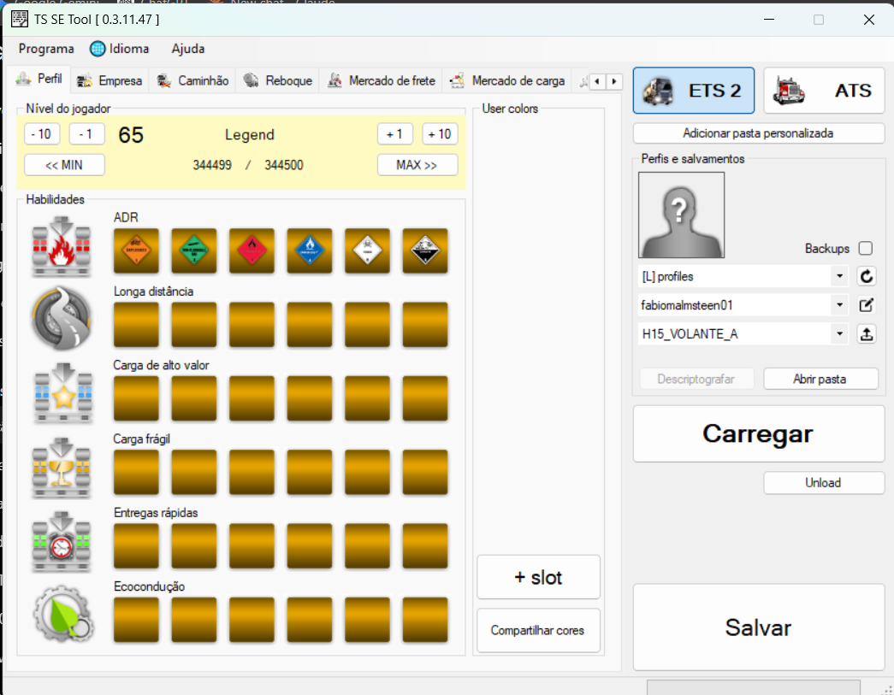

# TS SE Tool Community

[](https://github.com/fabiomesquita01/ts-se-tool-community/actions/workflows/build.yml)
[](LICENSE)
[](docs/COMPATIBILITY.md)
[](docs/COMPATIBILITY.md)

Continuação comunitária do **TS SE Tool**, editor de saves para Windows com foco no **Euro Truck Simulator 2**.

> **Versão atual:** `0.3.11.47 — RC5.1H21 Final`  
> **Suporte validado:** Euro Truck Simulator 2, save moderno de formato 97  
> **American Truck Simulator:** experimental e não validado nesta versão

[Download](../../releases/latest) · [Relatar problema](../../issues/new/choose) · [Documentação](docs/) · [English](README.en.md)



## Sobre o projeto

O projeto original foi criado por **LIPtoH**. Esta continuação comunitária preserva os créditos, a licença Apache 2.0 e os avisos de terceiros, enquanto adapta o editor para saves modernos do ETS2.

A prioridade é a **integridade do save**: alterações são preparadas, validadas e gravadas de forma cirúrgica. Recursos que exigem mutação estrutural ainda não comprovada permanecem bloqueados.

## Recursos principais

- edição de perfil, empresa, dinheiro, experiência, habilidades, cores e sede;
- gerenciamento de garagens e cidades visitadas;
- manutenção individual e em lote de caminhões e reboques;
- placa, combustível, odômetro e carga do reboque;
- troca controlada de caminhões e reboques em topologias validadas;
- Freight Market e Cargo Market com validação semântica;
- ferramentas de comboio para posição e rota GPS sem salvamento automático;
- editor de acessórios com alternativas verificadas;
- edição segura das seis habilidades dos motoristas IA;
- backups com data e hora antes da gravação;
- logs separados para operação, erros reais e compatibilidade.

## Segurança

1. Feche o ETS2 antes de editar.
2. Trabalhe em uma cópia de um save manual.
3. Preserve o backup criado pelo programa.
4. Faça uma alteração controlada por vez.
5. Recarregue o save no editor e depois valide no jogo.

O writer moderno preserva IDs, referências, ordem e quantidade das listas. Operações que não podem ser provadas com segurança são recusadas.

## Recursos intencionalmente bloqueados

- contratar ou demitir motoristas IA;
- editor bruto do grafo de caminhões e reboques;
- colagem completa de veículos;
- inserção, exclusão ou reordenação de blocos de acessórios;
- caminhos manuais de peças no modo Gamer;
- promessa de compatibilidade universal com DLCs e mods.

## Compatibilidade

A validação comunitária principal foi concluída no ETS2 usando save moderno de **formato 97**. Atualizações do jogo podem alterar o schema. Consulte [docs/COMPATIBILITY.md](docs/COMPATIBILITY.md).

O ATS não foi testado pelo mantenedor e não faz parte do aceite desta versão. Relatórios voluntários devem usar o formulário específico em **Issues**.

## Download

Use somente a seção [Releases](https://github.com/fabiomesquita01/ts-se-tool-community/releases/latest). Verifique o arquivo `SHA256SUMS.txt` antes de executar. Nesta versão, prefira o download manual pela página Releases; o fluxo automático herdado de atualização não faz parte da homologação H21.

## Compilação

Requisitos: Windows, Visual Studio/Build Tools 2022, .NET Framework 4.7.2 Targeting Pack e NuGet.

```powershell
nuget restore "TS SE Tool.sln"
msbuild "TS SE Tool.sln" /t:Rebuild /p:Configuration=Release /p:Platform="Any CPU"
```

O instalador auditado da versão final está em [`tools/`](tools/).

## Logs

- `log.log`: operações, preparação e validações;
- `errorlog.log`: erros reais e exceções;
- `compatibility.log`: campos novos ou desconhecidos preservados pela camada de compatibilidade.

Não publique saves sem remover dados pessoais do perfil.

## Créditos, suporte e redes

- **Projeto e autor original:** LIPtoH — <https://github.com/LIPtoH/TS-SE-Tool>
- **Continuação comunitária:** Fabio
- **E-mail:** `fabiomalmsteen@gmail.com`
- **Instagram:** [@fabio.meskita](https://www.instagram.com/fabio.meskita/)
- **GitHub:** [fabiomesquita01](https://github.com/fabiomesquita01)

## Licença e aviso

Licenciado sob a **Apache License 2.0**, com créditos e avisos originais preservados. Consulte [LICENSE](LICENSE) e [THIRD_PARTY_NOTICES.md](THIRD_PARTY_NOTICES.md).

Projeto comunitário independente, sem vínculo, patrocínio ou endosso da SCS Software. Edição incorreta ou uso após uma atualização incompatível pode corromper o progresso. Use por sua conta e risco e mantenha backups.
